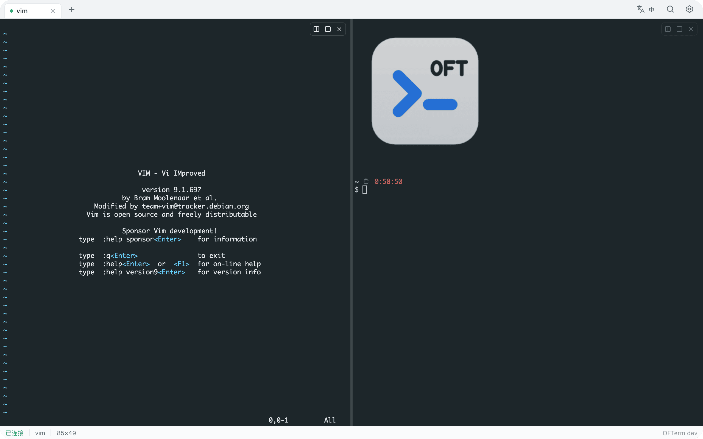
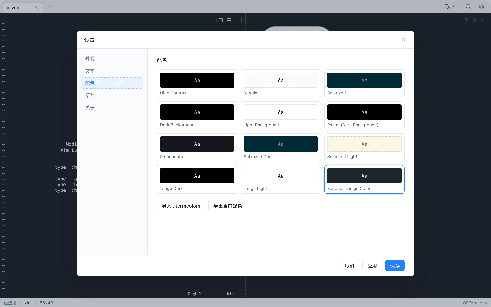
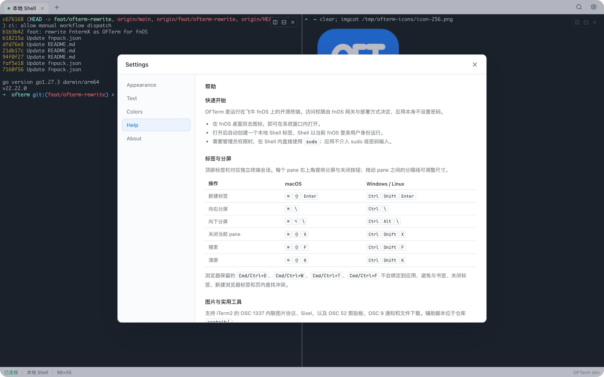
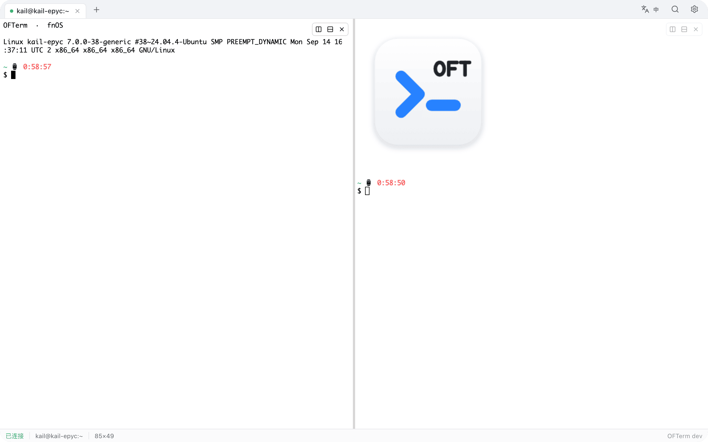

# OFTerm

**Open Fn Terminal —— 面向飞牛 fnOS 的 clean-room、GPL-2.0 终端。**

OFTerm 是独立开发的 fnOS 终端工作区。它在 fnOS 桌面窗口内提供 iTerm2 风格的标签页与分屏体验，视觉语言遵循飞牛官方设计，后端以单个静态 Go 二进制交付。

[English](README.md)


<table>
  <tr>
    <td width="50%" align="center"><br><sub>分屏工作区</sub></td>
    <td width="50%" align="center"><br><sub>配色预设</sub></td>
  </tr>
  <tr>
    <td width="50%" align="center"><br><sub>内置帮助</sub></td>
    <td width="50%" align="center"><br><sub>浅色主题</sub></td>
  </tr>
</table>

> **状态：预发布。** x86_64 与 arm64 安装包已经可以构建，但尚未提交或通过飞牛官方商店审核。首个稳定版前，界面与打包结构仍可能调整。

## 设计原则

1. **一个终端工作区。** 打开即进入终端，没有“本地/远程”首页，也没有应用密码。访问控制由 fnOS 负责。
2. **与 iTerm2 一致的操作习惯。** 标签、分屏、可拖动分隔线、非焦点 pane 变灰、Monaco 12 默认值、iTerm2 配色预设，都是产品的一部分。
3. **低运行成本。** 单个 Go 二进制，无解释器运行时，无内置会话守护进程，无外部 CDN，无遥测。

## 功能

### 终端工作区

- iTerm2 式标签页，支持关闭、排序与溢出滚动。
- 横向、纵向分屏，每个 pane 拥有独立 PTY 会话。
- 每个 pane 右上角提供悬浮分屏/关闭控件；分隔线可拖动调整比例。
- 非焦点 pane 自动降透明度，焦点 pane 保持正常对比度。
- 默认不持久化会话。WebSocket 异常断开后保留可配置的重连窗口，超时即终止 PTY。需要长期运行的进程，可在 Shell 内使用 `tmux` 或 `screen`。

### 字体与配色

- 默认终端字体：**Monaco 12**，字重 400，行距 1.0，关闭连字——与 iTerm2 默认 Profile 一致。
- 跨平台回退：Menlo → SF Mono → DejaVu Sans Mono → JetBrains Mono（内置 OFL 字体，仅 Latin 子集）。
- 内置 iTerm2 预设：High Contrast、Regular、Solarized、Dark/Light Background、Pastel、Smooooooh、Solarized Dark/Light、Tango Dark/Light。
- 默认主题：**Material Design Colors**。
- 支持导入、导出 `.itermcolors` 文件。导入的配色随应用设置持久化，并与内置预设一起显示。
- 界面与终端联动：分屏背景、分隔线颜色、非焦点 pane 的灰度均跟随当前配色。

### 终端能力

- xterm.js 6，优先 WebGL，失败时回退 DOM renderer。
- iTerm2 内联图片协议（OSC 1337，含 MultipartFile 重组）与 Sixel。
- OSC 52 剪贴板、OSC 9 通知、文件下载、窗口标题。
- 搜索高亮采用 iTerm2 风格黄色。
- 支持全屏程序、鼠标报告、bracketed paste、Unicode 11 宽度。

### 辅助脚本

`contrib/` 提供与 iTerm2 Utilities 兼容的工具集：

| 命令 | 用途 |
|---|---|
| `imgcat`、`imgls` | 来自 iTerm2（GPL-2.0），未修改 |
| `ofn-imgcat`、`ofn-imgls` | 按终端尺寸缩图后再传输 |
| `ofn-copy` | OSC 52 剪贴板 |
| `ofn-notify` | OSC 9 通知 |
| `ofn-dl` | 从 Shell 下载文件到浏览器 |
| `ofn-title` | 设置标签标题 |
| `ofn-check` | 检查终端能力 |

从 GitHub 安装：

```bash
curl -fsSL https://raw.githubusercontent.com/melchior-voidwolf/ofterm/main/contrib/install-utils.sh | bash
```

## 键盘快捷键

浏览器保留的按键（`Cmd/Ctrl+D`、`Cmd/Ctrl+W`、`Cmd/Ctrl+T`、`Cmd/Ctrl+F`）不会绑定到应用。

| 操作 | macOS | Windows / Linux |
|---|---|---|
| 新建标签 | `Cmd+Shift+Enter` | `Ctrl+Shift+Enter` |
| 向右分屏 | `Cmd+\` | `Ctrl+\` |
| 向下分屏 | `Cmd+Option+\` | `Ctrl+Alt+\` |
| 关闭当前 pane | `Cmd+Shift+X` | `Ctrl+Shift+X` |
| 搜索 | `Cmd+Shift+F` | `Ctrl+Shift+F` |
| 清屏 | `Cmd+Shift+K` | `Ctrl+Shift+K` |

每个 pane 右上角也提供悬浮分屏与关闭按钮。

## 架构

```text
cmd/ofterm                 进程入口、信号、版本
internal/app               装配与生命周期
internal/gateway           Unix/TCP listener、网关前缀
internal/auth              一次性 WebSocket ticket
internal/httpapi           REST API 与终端 WebSocket
internal/term              会话接口与限额
internal/term/local        PTY、进程组收敛
internal/store             bbolt 持久化
internal/web               内嵌 React 构建产物
```

- **后端：** Go，`CGO_ENABLED=0`，静态链接。
- **前端：** React 19 + TypeScript + Vite + xterm.js。
- **传输：** 二进制 WebSocket 帧，带序号、resize、exit、error 控制消息。
- **会话模型：** 一个 WebSocket 对应一个 PTY。断开后启动可配置的 grace 计时；重连从最后序号恢复；超时终止进程组。
- **数据：** bbolt，位于 `${TRIM_PKGVAR}`。仅保存设置、命令片段与导入的配色。不保存 SSH 主机或凭据。
- **访问控制：** 完全交给 fnOS。网关模式只从 Unix Listener 读取 `X-Trim-*`；直连模式默认绑定 `127.0.0.1`，使用当前系统用户。应用不设密码。

## 仓库结构

```text
fnpack.json                  FnDepot 索引
ofterm/                      FnDepot 应用目录（图标、预览、说明）
packaging/ofterm/            官方 fnpack 项目模板
src/backend/                 Go 后端
src/frontend/                React 前端
build/architectures.json     架构矩阵（唯一架构来源）
scripts/build-fpk.mjs        交叉编译 + fnpack 打包
themes/                      配色数据与溯源
contrib/                     iTerm2 兼容辅助脚本
docs/                        架构、安全、隐私、兼容性文档
```

## 下载

- **release 分支构建：** https://github.com/melchior-voidwolf/ofterm/releases/download/release/ofterm_0.1.7-dev_x86.fpk
- **release 分支构建（ARM）：** https://github.com/melchior-voidwolf/ofterm/releases/download/release/ofterm_0.1.7-dev_arm.fpk
- **稳定版：** 打 `v*` tag 后使用 `https://github.com/melchior-voidwolf/ofterm/releases/latest/download/ofterm_0.1.7-dev_x86.fpk`（或 `ofterm_0.1.7-dev_arm.fpk`）。

`fnpack.json` 指向稳定版；预发布构建使用显式的 `release` tag。

## 构建

依赖：Go 1.27+、Node.js 22+、官方 `fnpack` CLI。

```bash
# 1. 构建前端
cd src/frontend
npm ci
npm run build

# 2. 构建开发用后端
cd ../backend
go build -o /tmp/ofterm ./cmd/ofterm

# 3. 构建 x86_64 与 arm64 安装包
cd ../..
curl -fsSL -o /tmp/fnpack https://static2.fnnas.com/fnpack/fnpack-1.2.3-darwin-arm64
chmod +x /tmp/fnpack
FNPACK=/tmp/fnpack VERSION=0.1.0 node scripts/build-fpk.mjs --all
```

产物位于 `build/out/ofterm_0.1.7-dev_x86.fpk` 与 `build/out/ofterm_0.1.7-dev_arm.fpk`。

本地开发：

```bash
cd src/backend
go build -o /tmp/ofterm ./cmd/ofterm
OFTERM_MODE=direct OFTERM_LISTEN=127.0.0.1:5122 OFTERM_DATA_DIR=/tmp/ofterm-data /tmp/ofterm serve
```

## CI 与发布

- `.github/workflows/ci.yml`：在 `main`/`master`/PR 上运行前端测试与构建、后端 vet/测试和 Linux 交叉编译，不发布安装包。
- `.github/workflows/release.yml`：在 `release` 分支和 `v*` tag 上构建。推送到 `release` 发布会滚动预发布（tag 为 `release`）；`v*` tag 发布稳定版。
- 两个渠道都会附加 `ofterm_0.1.7-dev_x86.fpk`、`ofterm_0.1.7-dev_arm.fpk` 和 `SHA256SUMS`。
- `build/architectures.json` 是唯一的架构来源。新增 Go 支持的架构不需要修改后端。

## 安全与隐私

- 无遥测、无第三方分析、无 CDN 依赖。
- 不设应用密码。访问控制由 fnOS 负责；直连模式除非显式修改，否则只监听回环地址。
- WebSocket 使用一次性、短期 ticket，通过 subprotocol 传递，不在长期 URL 中携带凭据。
- 不保存 SSH 主机或凭据；需要连接其他主机时，在 Shell 内使用系统 `ssh`。
- 设置与导入的配色只保存在 NAS 本地。
- 详见 [docs/SECURITY.md](docs/SECURITY.md)、[docs/PRIVACY.md](docs/PRIVACY.md)、[docs/ARCHITECTURE.md](docs/ARCHITECTURE.md)。

## 兼容性

- fnOS 最新统一网关版本。`os_min_version` 只在真机验证后填写。
- 浏览器：Safari 15+/iOS 15+、Chrome/Edge 100+、Firefox 100+。
- 架构：x86_64、arm64；构建矩阵已为 `linux/loong64` 预留，待 fnOS 官方开放对应 platform 值。

## 许可

OFTerm 使用 **GNU General Public License v2.0**，见 [LICENSE](LICENSE)。

第三方声明见 [NOTICE](NOTICE) 与 [THIRD_PARTY_LICENSES.md](THIRD_PARTY_LICENSES.md)。iTerm2 是 George Nachman 的商标；OFTerm 与 iTerm2、fnOS 均无隶属或背书关系。

OFTerm 是 clean-room 实现。FntermX 未公开源码；本项目未复用其任何代码、二进制、图标或素材，见 [docs/CLEANROOM.md](docs/CLEANROOM.md)。
