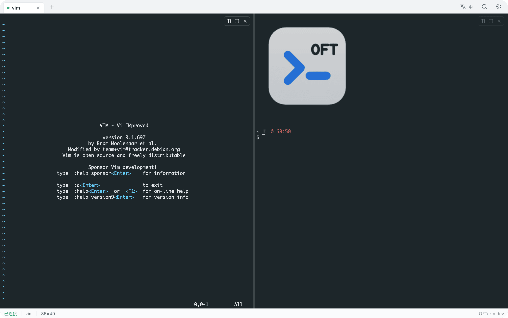
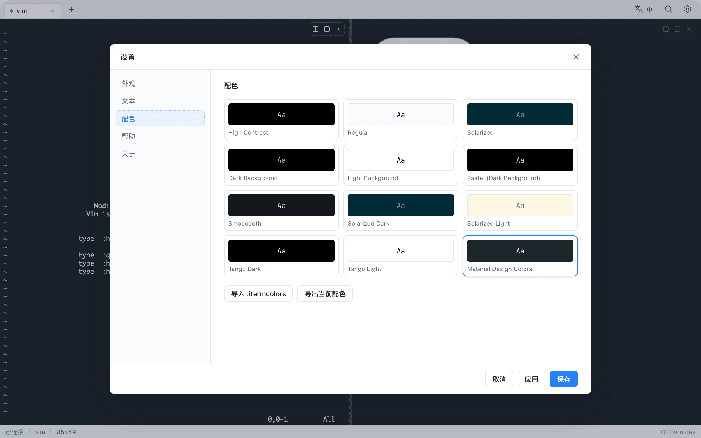
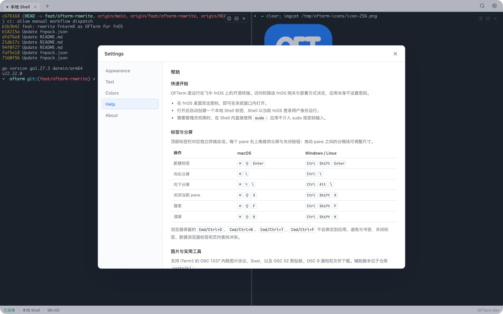
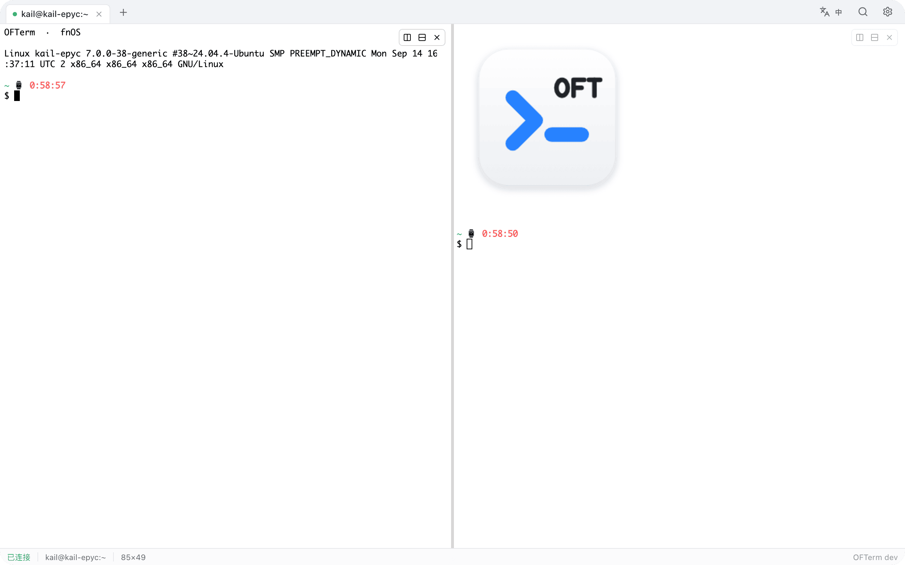

# OFTerm

**Open Fn Terminal — a clean-room, GPL-2.0 terminal for fnOS.**

OFTerm is an independent terminal workspace for [fnOS](https://www.fnnas.com/). It provides an iTerm2-style tab and split-pane interface inside the fnOS desktop window, with a restrained visual system aligned to fnOS and a Go backend that ships as a single static binary.

[中文说明](README-cn.md)


<table>
  <tr>
    <td width="50%" align="center"><br><sub>Split workspace</sub></td>
    <td width="50%" align="center"><br><sub>Color presets</sub></td>
  </tr>
  <tr>
    <td width="50%" align="center"><br><sub>Built-in help</sub></td>
    <td width="50%" align="center"><br><sub>Light theme</sub></td>
  </tr>
</table>

> **Status:** pre-release. The package builds for x86_64 and arm64, but it has not yet been submitted to or approved by the fnOS app store. Interfaces and packaging may change before the first stable release.

## Design

OFTerm is built around three constraints:

1. **One terminal workspace.** Opening the app enters the terminal directly. There is no local/remote landing page and no application password. Access control belongs to fnOS.
2. **iTerm2-compatible behavior.** Tabs, split panes, draggable dividers, inactive-pane dimming, Monaco 12 defaults, and iTerm2 color presets are part of the product.
3. **Low operational cost.** A single Go binary, no runtime interpreter, no bundled session daemon, no external CDN, and no telemetry.

## Features

### Terminal workspace

- iTerm2-style tabs with close, reorder, and overflow behavior.
- Horizontal and vertical split panes, each with its own PTY session.
- Per-pane floating controls for split and close; draggable dividers.
- Inactive panes are dimmed; the focused pane stays at full contrast.
- No persistent sessions by design. A dropped WebSocket keeps a short grace window for reconnection, then terminates the PTY. Users who need persistence can run `tmux` or `screen` inside the shell.

### Typography and color

- Default terminal font: **Monaco 12**, weight 400, line spacing 1.0, ligatures disabled — matching the iTerm2 default profile.
- Cross-platform fallback: Menlo → SF Mono → DejaVu Sans Mono → JetBrains Mono (bundled, OFL, Latin subset).
- Built-in iTerm2 presets: High Contrast, Regular, Solarized, Dark/Light Background, Pastel, Smooooooh, Solarized Dark/Light, Tango Dark/Light.
- Default theme: **Material Design Colors**.
- Import and export `.itermcolors` files. Imported palettes are stored with the application settings and appear alongside built-in presets.
- Theme-aware chrome: terminal background, divider color, and inactive-pane dimming follow the active palette.

### Terminal capabilities

- xterm.js 6 with WebGL rendering and DOM fallback.
- iTerm2 inline images (OSC 1337, including MultipartFile reassembly) and Sixel.
- OSC 52 clipboard, OSC 9 notifications, file download, and window title.
- Search with iTerm2-style yellow highlights.
- Full-screen applications, mouse reporting, bracketed paste, and Unicode 11 width handling.

### Utilities

`contrib/` contains an iTerm2-compatible utility set:

| Command | Purpose |
|---|---|
| `imgcat`, `imgls` | Vendored from iTerm2 (GPL-2.0), unmodified |
| `ofn-imgcat`, `ofn-imgls` | Size-aware wrappers that downscale before transfer |
| `ofn-copy` | OSC 52 clipboard |
| `ofn-notify` | OSC 9 notification |
| `ofn-dl` | Download a file from the shell to the browser |
| `ofn-title` | Set the tab title |
| `ofn-check` | Capability probe |

Install from GitHub:

```bash
curl -fsSL https://raw.githubusercontent.com/melchior-voidwolf/ofterm/main/contrib/install-utils.sh | bash
```

## Keyboard shortcuts

Browser-reserved combinations (`Cmd/Ctrl+D`, `Cmd/Ctrl+W`, `Cmd/Ctrl+T`, `Cmd/Ctrl+F`) are intentionally not bound.

| Action | macOS | Windows / Linux |
|---|---|---|
| New tab | `Cmd+Shift+Enter` | `Ctrl+Shift+Enter` |
| Split right | `Cmd+\` | `Ctrl+\` |
| Split down | `Cmd+Option+\` | `Ctrl+Alt+\` |
| Close pane | `Cmd+Shift+X` | `Ctrl+Shift+X` |
| Search | `Cmd+Shift+F` | `Ctrl+Shift+F` |
| Clear screen | `Cmd+Shift+K` | `Ctrl+Shift+K` |

Each pane also exposes split and close controls in its upper-right corner.

## Architecture

```text
cmd/ofterm                 process entry, signals, version
internal/app               wiring and lifecycle
internal/gateway           Unix/TCP listeners, gateway prefix
internal/auth              one-time WebSocket tickets
internal/httpapi           REST API and terminal WebSocket
internal/term              session interface and limits
internal/term/local        PTY, process containment
internal/store             bbolt persistence
internal/web               embedded React build
```

- **Backend:** Go, `CGO_ENABLED=0`, statically linked.
- **Frontend:** React 19 + TypeScript + Vite + xterm.js.
- **Transport:** binary WebSocket frames with sequence numbers, resize, exit, and error control messages.
- **Session model:** one WebSocket maps to one PTY. Disconnect starts a configurable grace timer; reconnect resumes from the last sequence number; expiry terminates the process group.
- **Data:** bbolt under `${TRIM_PKGVAR}`. Settings, snippets, and imported palettes only. No SSH hosts or credentials are stored.
- **Access control:** delegated to fnOS. Gateway mode reads `X-Trim-*` only from the Unix listener; direct mode binds `127.0.0.1` by default and uses the process user. There is no application password.

## Repository layout

```text
fnpack.json                  FnDepot index
ofterm/                      FnDepot app directory (icons, previews, README)
packaging/ofterm/            official fnpack project template
src/backend/                 Go backend
src/frontend/                React frontend
build/architectures.json     architecture matrix (single source of truth)
scripts/build-fpk.mjs        cross-compile + fnpack packaging
themes/                      color data and provenance
contrib/                     iTerm2-compatible utilities
docs/                        architecture, security, privacy, compatibility
```

## Download

- **Release branch build:** https://github.com/melchior-voidwolf/ofterm/releases/download/release/ofterm_0.1.8-dev_x86.fpk
- **Release branch build (ARM):** https://github.com/melchior-voidwolf/ofterm/releases/download/release/ofterm_0.1.8-dev_arm.fpk
- **Stable release:** after a `v*` tag, use `https://github.com/melchior-voidwolf/ofterm/releases/latest/download/ofterm_0.1.8-dev_x86.fpk` (or `ofterm_0.1.8-dev_arm.fpk`).

`fnpack.json` points at the stable release; prerelease builds use the `release` tag explicitly.

## Build

Requirements: Go 1.27+, Node.js 22+, and the official `fnpack` CLI.

```bash
# 1. Frontend
cd src/frontend
npm ci
npm run build

# 2. Backend (development binary)
cd ../backend
go build -o /tmp/ofterm ./cmd/ofterm

# 3. Packages (x86_64 + arm64)
cd ../..
curl -fsSL -o /tmp/fnpack https://static2.fnnas.com/fnpack/fnpack-1.2.3-darwin-arm64
chmod +x /tmp/fnpack
FNPACK=/tmp/fnpack VERSION=0.1.0 node scripts/build-fpk.mjs --all
```

Artifacts are written to `build/out/ofterm_0.1.8-dev_x86.fpk` and `build/out/ofterm_0.1.8-dev_arm.fpk`.

Local development:

```bash
cd src/backend
go build -o /tmp/ofterm ./cmd/ofterm
OFTERM_MODE=direct OFTERM_LISTEN=127.0.0.1:5122 OFTERM_DATA_DIR=/tmp/ofterm-data /tmp/ofterm serve
```

## CI and releases

- `.github/workflows/ci.yml` runs on `main`/`master`/PRs: frontend tests/build, backend vet/tests, and linux cross-compilation. It does not publish packages.
- `.github/workflows/release.yml` runs on the `release` branch and on `v*` tags. Pushes to `release` publish a rolling prerelease (tag `release`); tags publish a stable release.
- Both channels attach `ofterm_0.1.8-dev_x86.fpk`, `ofterm_0.1.8-dev_arm.fpk`, and `SHA256SUMS`.
- `build/architectures.json` is the only architecture source. Adding a Go-supported target does not require backend changes.

## Security and privacy

- No telemetry, no external analytics, no CDN dependencies.
- No application password. fnOS owns access control; direct mode is loopback-only unless explicitly reconfigured.
- WebSocket authorization uses one-time, short-lived tickets carried in a subprotocol rather than long-lived URL credentials.
- No SSH host or credential storage. Use the system `ssh` client inside the shell.
- Settings and imported themes remain on the NAS.
- See [docs/SECURITY.md](docs/SECURITY.md), [docs/PRIVACY.md](docs/PRIVACY.md), and [docs/ARCHITECTURE.md](docs/ARCHITECTURE.md).

## Compatibility

- fnOS latest unified-gateway release. `os_min_version` is set only after device validation.
- Browser targets: Safari 15+/iOS 15+, Chrome/Edge 100+, Firefox 100+.
- Architectures: x86_64 and arm64; the build matrix is ready for `linux/loong64` once fnOS exposes the platform value.

## License

OFTerm is licensed under the **GNU General Public License v2.0**. See [LICENSE](LICENSE).

Third-party attributions are in [NOTICE](NOTICE) and [THIRD_PARTY_LICENSES.md](THIRD_PARTY_LICENSES.md). iTerm2 is a trademark of George Nachman; OFTerm is not affiliated with or endorsed by iTerm2 or fnOS.

OFTerm is a clean-room implementation. FntermX is not open source; no FntermX code, binary, icon, or other asset is reused. See [docs/CLEANROOM.md](docs/CLEANROOM.md).
